<picture>
  <source media="(prefers-color-scheme: dark)" srcset="assets/header-dark.svg">
  
</picture>

[Portafolio](https://bel001.github.io/Portafolio/) · [LinkedIn](https://www.linkedin.com/in/rodrigo-abel-rodr%C3%ADguez-malca-b33ab5342/)

