<picture>
  <source media="(prefers-color-scheme: dark)" srcset="assets/header-dark.svg">
  
</picture>

 

Estudio [Ingeniería de Sistemas] en [UPAO] y me gusta hacer cosas que la gente de verdad use: un horario que se arma solo, una app que te ordena el ciclo, un sistema que avisa cuando alguien entra a obra sin casco.

Ahora mismo estoy con **AgroOrbit Nexus** y busco [prácticas pre-profesionales].

[Portafolio](https://bel001.github.io/Portafolio/) &nbsp;·&nbsp; [LinkedIn](https://www.linkedin.com/in/rodrigo-abel-rodr%C3%ADguez-malca-b33ab5342/)

 

## Proyectos

<a href="https://github.com/bel001/UniThrive-App">Código</a>

<a href="https://horatriz.vercel.app"><b>Probar demo</b></a> &nbsp;·&nbsp; <a href="https://github.com/bel001/Horatriz">Código</a>

<a href="https://agroorbit-nexus.vercel.app"><b>Probar demo</b></a> &nbsp;·&nbsp; <a href="https://github.com/bel001/AgroOrbit-Nexus">Código</a>

<a href="https://github.com/bel001/Sistema-multiagente-Packia-Express">Código</a>

<a href="https://github.com/bel001/Sistema-de-deteccion-de-EPP-en-construccion">Código</a>

 

## Con qué trabajo

 
 

Más proyectos en mi [portafolio](https://bel001.github.io/Portafolio/).
